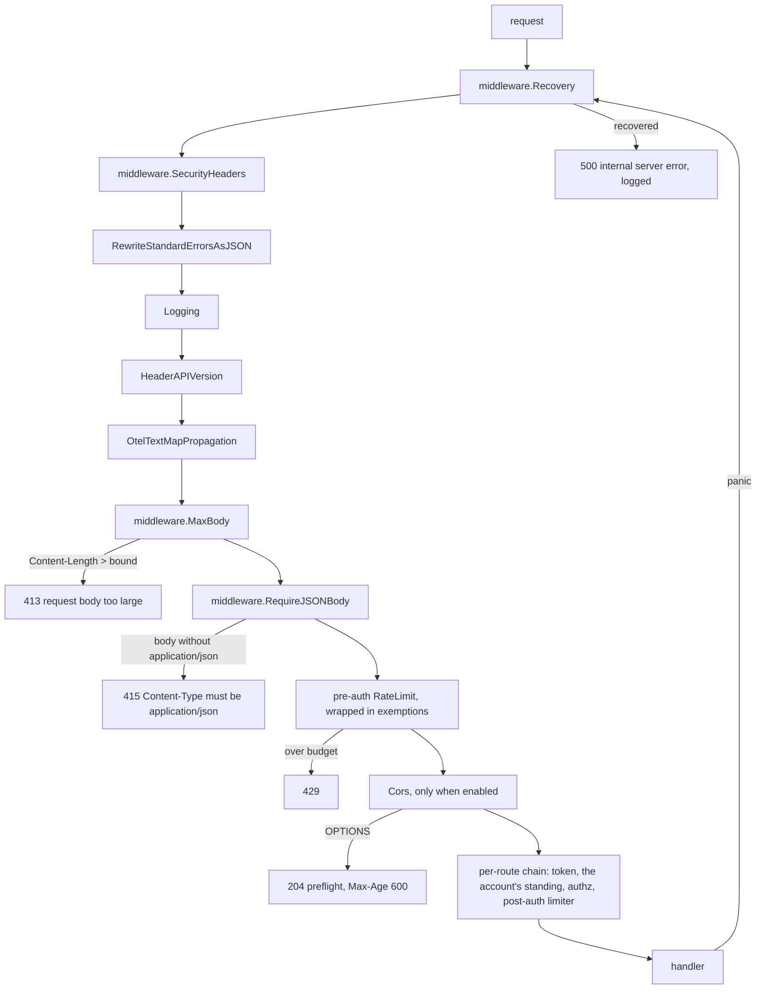
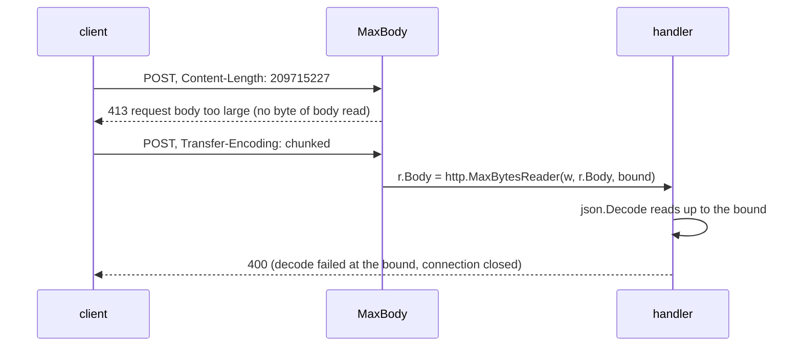
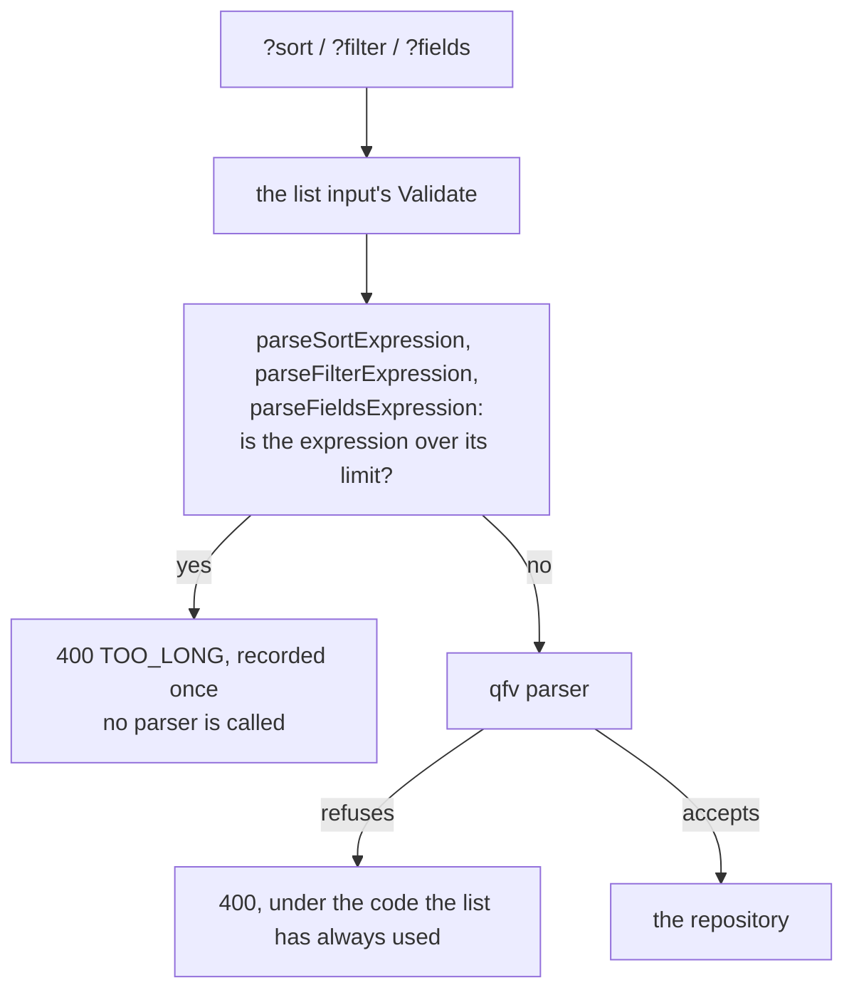
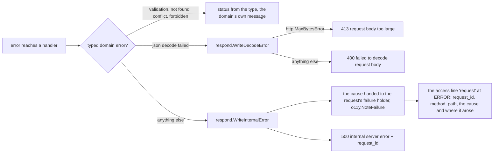
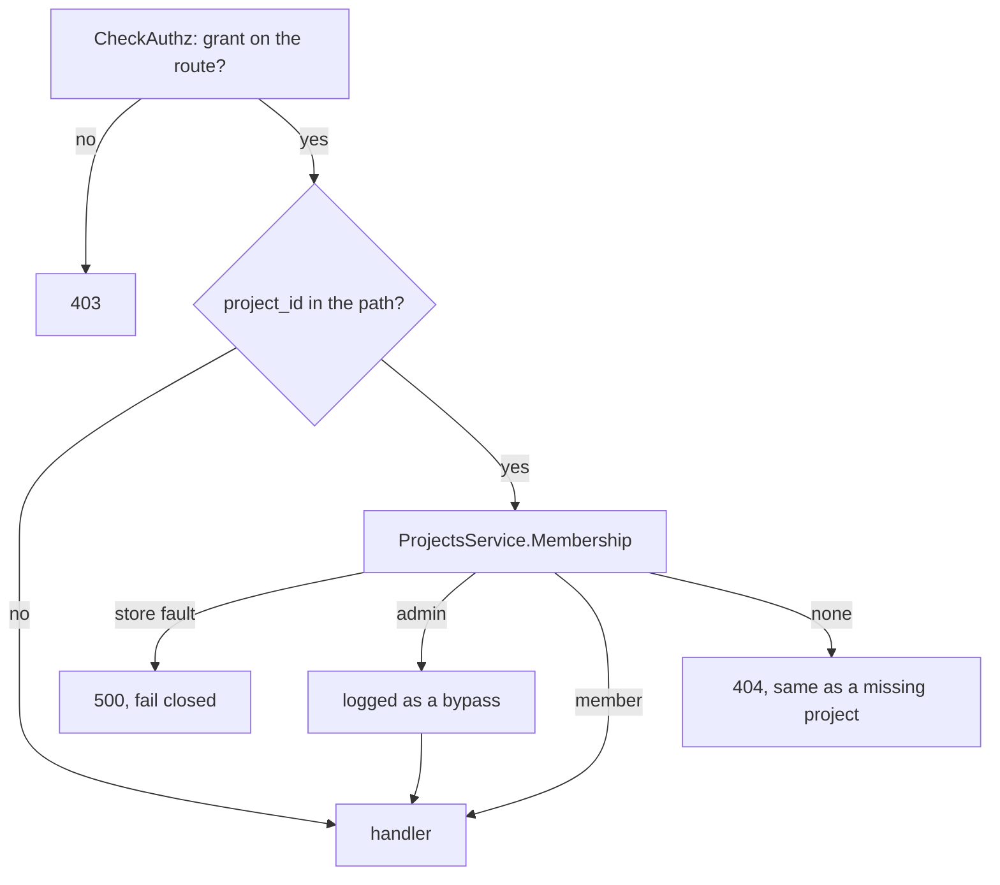
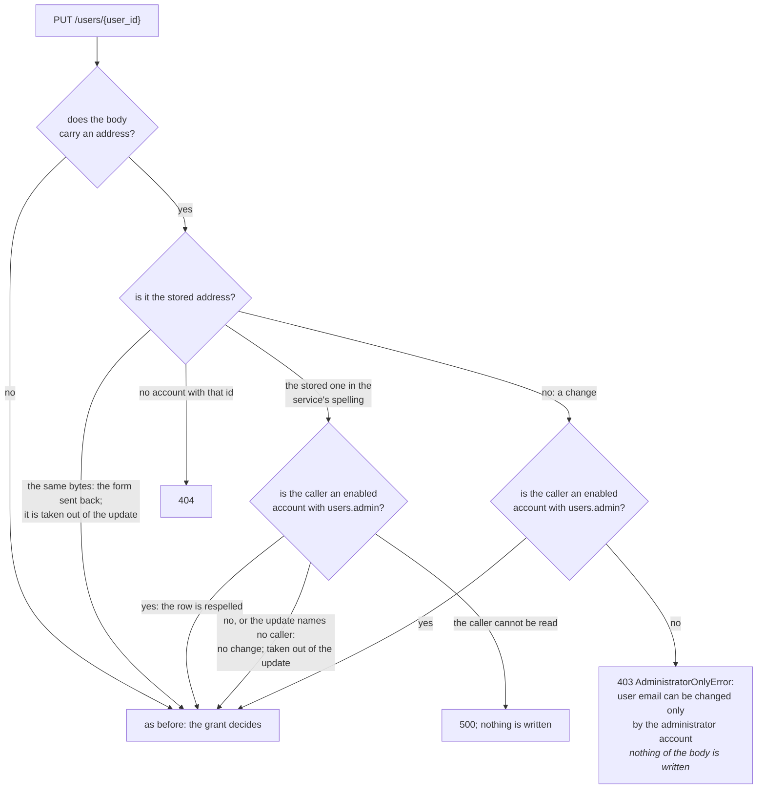
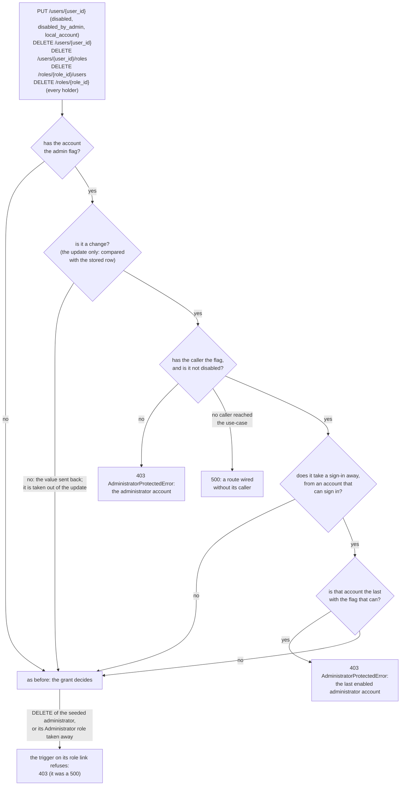
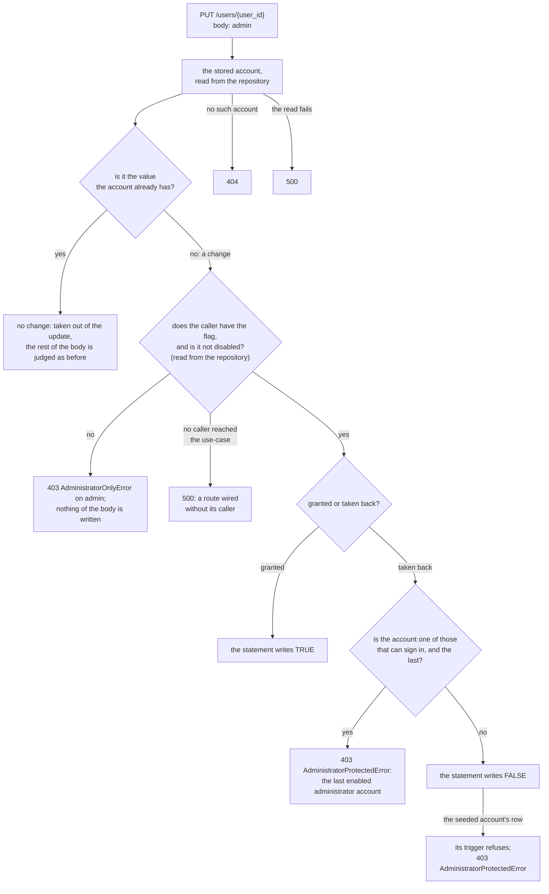
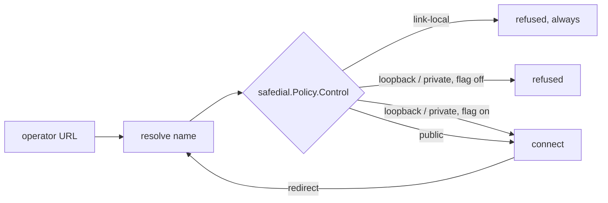

# API security: response hygiene and request bounds

> Written for `svc-qu3ry-core` and ported here unchanged. The template has no
> embedding ingest route and no LLM engines, so the large-body bound applies
> to nothing until a service adds a bulk route, and the outbound guard covers
> the identity providers only. Everything else applies as written.

This is the transport-level posture of the API: what every response carries,
what every request is refused for before a handler sees it, and why each
piece is there. The authentication, rate-limiting and identity-provider
documents cover their own layers; this one is what sits around all of them.

It was written while fixing the absence of all of it. Until 2026-09-06 the
API set one response header of its own (`X-API-Version`), bounded no request
body, checked no content type, built `Location` from the caller's `Origin`
header, and had a panic-recovery middleware that was documented as outermost
and wired nowhere. Each section below says what that cost, measured.

## The common chain

Every request through the API prefix passes this chain, outermost first.
`internal/app/server.go` builds it and
`TestEveryRequestIsRecoveredBoundedAndHeadered` reads that file and fails if
the first four or the limiter-before-CORS order change.



Two positions are load-bearing and were both wrong before:

- **Recovery is first.** A panic below it becomes a logged 500. Without it
  Go's server recovers per connection and closes it: the client sees an
  empty reply and the log has nothing structured. It was defined in
  `middleware` and described in `middleware/doc.go` as "outermost" for as
  long as the package existed, and no chain contained it.
- **CORS is after the limiter.** The CORS middleware answers a preflight
  itself. Placed before the limiter, every `OPTIONS` was answered for free,
  which is an unmetered request against any path. A preflight that is
  rate-limited gets a 429 without CORS headers, which a browser treats as a
  refusal. That is the right answer.

## What every response carries

`middleware.SecurityHeaders` sets these before the handler runs, so an early
refusal (a 413, a 415, a 429) carries them as well.

| Header | Value | What it closes |
| --- | --- | --- |
| `X-Content-Type-Options` | `nosniff` | a JSON body that contains markup is never rendered as a page |
| `Cache-Control` | `no-store` | a login answer carries two tokens; a list carries what the caller was authorised to see; nothing here is public, and a shared cache decides heuristically when told nothing |
| `Content-Security-Policy` | `default-src 'none'; frame-ancestors 'none'` | a JSON body loads nothing and is framed by nothing; a proxy or error page that serves it as HTML is inert |
| `X-Frame-Options` | `DENY` | `frame-ancestors` for agents that predate CSP |
| `Referrer-Policy` | `no-referrer` | an API URL can carry an id; it does not travel to wherever a client goes next |
| `Cross-Origin-Resource-Policy` | `same-origin` | an `` or `<script>` pointed at the API from another origin gets nothing; CORS requests are governed by the CORS middleware, not this |
| `Strict-Transport-Security` | `max-age=63072000; includeSubDomains` | only when TLS terminates here (`http.server.tls.enabled`) or `http.server.hsts.enabled` says a proxy does; over plain HTTP a browser ignores it, so the switch exists to avoid claiming a posture the deployment does not have |

**The swagger UI is the exception.** It is the one page this server serves,
mounted on the same router. It keeps every header that never breaks a page
and loses the two that would: `no-store`, which would make its assets
uncacheable, and the API's CSP, which would block its own scripts. The
composition root passes `IsDocument` for the `/swagger/` prefix.

**No `Server` header** is sent; Go's server does not add one and nothing
here does.

## Request bounds

### Body size

`middleware.MaxBody` bounds every body. There was no bound: each handler
decodes `r.Body` with `encoding/json`, and `http.server.read.timeout` is off
by design because bulk ingest over a slow link is legitimate, so one request
could allocate whatever it sent.

```text
measured 2026-09-06, 200 MiB JSON body to POST /auth/login
before: 400 after 0.66 s, process RSS 52 MiB -> 674 MiB
after:  413 after 0.0008 s, RSS unchanged
```

Two mechanisms, because clients come in two shapes:



| Setting | Default | Applies to |
| --- | --- | --- |
| `http.server.max.body.bytes` | 1 MiB | every route |
| `http.server.max.body.bytes.ingest` | 32 MiB | `POST …/embeddings/ingest`, the one route that posts a corpus; must not be below the first |

The ingest route also caps **work**, not just bytes:
`domain.MaxEmbeddingChunksPerRequest` (1 000) bounds the chunks one request
may carry, because each chunk is an embedding call and a row. A larger corpus
is sent in batches.

### List expressions

A list's `sort`, `filter` and `fields` arrive in the query string, which
`MaxBody` does not bound: a request line may be as long as
`http.server.max.header.bytes` allows, 1 MiB by default. Each expression has
its own limit (`filter` 2 048 bytes, `sort` and `fields` 1 024), and **an
expression over its limit is refused before any parser sees it**.

It was not. The length check recorded `TOO_LONG` and the expression was parsed
anyway, on six lists, so the caller heard the length and then the parser's
complaint about the same text; four lists had no length check at all, and an
expression of any size was parsed there.

The filter parser is recursive, and until qfv `v1.0.3` its depth was the
caller's to choose: a deeply nested filter overflowed the stack. That is a
fatal error of the runtime, not a panic: `Recovery` does not catch it and no
handler can. The parser bounds its own depth now, a hundred levels. The
length bound stays in front of it: it is the cheaper refusal, it covers the
sort and the fields, and it does not depend on what a library does with a
megabyte of input.



The bound is in the three functions of `domain/list_expressions.go`, the one
place the parsers are used (`TestListExpressionsAreParsedInOnePlace`), and no
longer in each input's `Validate`, where four of ten had forgotten it.
`TestAnOverLongExpressionIsNotParsed` hands every list input a sort, a filter
and fields one character over their limit, and malformed, and holds one
`TOO_LONG` for each and nothing else; `TestEveryListInputIsListed` fails when
a new list input is not among them.

### Content type

`middleware.RequireJSONBody` refuses a request that carries a body without
declaring it `application/json` (parameters such as `charset` are fine). It
keys on the presence of a body, not the method: a `DELETE` with a JSON body
(bulk delete) is a body like any other, and a `POST` without one (logout) is
not asked to describe what it did not send.

Two reasons beyond tidiness. A browser sends a cross-origin form post without
a preflight, only because form content types are "simple"; requiring
`application/json` makes the preflight, and so the CORS policy, apply to every
write. And a client that sends the wrong type is told so at the door, in one
wording, instead of by whatever the decoder makes of it.

The integration suite's request helper sets the header on every body it
sends. It never did before, which is why this check would have failed the
whole suite and why the helper is part of the same change.

## `Location` is built from configuration, never from a request header

Every create answered 201 with
`Location: <Origin header><RequestURI>/<id>`. Measured 2026-09-06:
`POST /roles` with `Origin: http://evil.example` answered
`Location: http://evil.example/api/v1/roles/<id>`. A client that follows
`Location` was sent wherever the caller said. It also kept the query string,
so a create through `?x=1` produced `…/roles?x=1/<id>`.

`respond.LocationFor` builds the path from the request path (query dropped)
plus the segments the handler names, and prefixes `http.server.public.url`
when it is set. Unset, the result is a path reference
(`/api/v1/roles/<id>`), which RFC 9110 allows and every client resolves
against the request it made. All 29 sites go through it.

## Errors: one wording per class, the cause in the log

Handlers used to write `err.Error()` into the body of every 500 and of every
failed decode. Counted on 2026-09-06: 218 sites of the first kind and 49 of
the second, so `encoding/json`'s "unexpected EOF", pgx's SQLSTATE text and
the pagination cursor decoder's "invalid cursor: not base64" were all part
of the API's contract, and every dependency bump could reword it. The JWT
middleware had already fixed this for itself ("Invalid or expired token",
one place, the reason at DEBUG); the rule is now enforced package-wide.



- **`respond.WriteInternalError`** answers `"internal server error"` and
  hands the cause to the request's failure holder; the access line, written
  at ERROR for a 5xx, carries it under the request id
  ([observability.md](observability.md#a-failed-request-is-one-line-at-the-level-of-its-answer)).
  A 500 is by definition an error the caller cannot act on; the operator
  can, and joins the two by the id.
- **`respond.WriteDecodeError`** answers one 400 wording for any decode
  failure, and 413 when the body was cut by the size bound, so a client
  learns to send less rather than to fix its JSON.
- **Pagination tokens** answer `invalid next_token` / `invalid prev_token`. A
  token is opaque; how it failed is nothing a client acts on.
- **`domain.IDPUnreachableError`** is its own type, mapped to 503. It used to
  be told apart from every other authn failure by searching the message for
  "not reachable".
- **`TestNoHandlerForwardsALibraryErrorString`** reads the handler package
  and fails on either shape coming back. Same idea as the zero-`errors.As`
  invariant: the number worth recording is zero.
- **A list that fails says whose mistake it was** (`writeListError`).
  Seventeen of the eighteen lists wrote the error's text at whatever status
  it mapped to (the rate-limit rules' list had a helper of its own, which
  did not). A refused sort, filter or field list is a 400 in the error's
  words, which is meant; anything else was a 500 in the words of whatever
  broke. The guard above looks for `StatusInternalServerError` beside
  `.Error()`, and these sites spelled the status as a call, so it never saw
  them. A 500 from a list goes through `respond.WriteInternalError` now.
- **Two guards read the syntax tree for the shape itself.**
  `TestNoHandlerWritesAnErrorsTextAtA500`: no answer at a status the call
  does not name (one place, the helper), and at a 5xx the message is a
  sentence of the service's, read from the argument: a string, a constant,
  or a name that was only ever given one. An error's text, a `Sprintf` of
  it, or a variable that holds either is not, however it is spelled.
  `TestEveryListAnswersItsFailureThroughTheHelper`: a handler that reads the
  list parameters answers through the helper once, with the failure it
  recorded, and returns.
- **Two 503s carry an error's text on purpose**: a sign-in through an
  identity provider that cannot be reached, at its start and at its
  callback. Each is a branch on `IDPUnreachableError`, whose sentence the
  service writes ("the identity provider is not reachable"), and the first
  guard lists them with the type it requires the branch to be on. The start
  routes answered 500 for it, though they document 503: their 503 was on
  the type of another failure, which building the authorization URL never
  returns. `TestAnUnreachableProviderAtTheStartIsA503`.
- **What a 400 says is not always the service's sentence yet.** Four kinds
  of refusal that come from the database (a byte sequence, a message
  format, a column that does not exist, a type that does not match) are
  typed, answered 400, and still carry PostgreSQL's own sentence; and a
  filter PostgreSQL refuses for any other reason is not typed at all, so it
  is a 500, which now says nothing instead of quoting PostgreSQL.

### The request id

`middleware.RequestID` is the outermost middleware, above `Recovery`, so a
recovered panic has an id too. It mints a v7 uuid per request, returns it in
`X-Request-ID`, puts it on the request log line, and repeats it in every
error body as `request_id`. An inbound `X-Request-ID` is not honoured: a log
an attacker can fill with chosen ids is worse than one with only ours.

## Ownership: a grant names a route, membership names a project

The authorization policy answers "may this user call
`GET /projects/{any}/embedding_configs`", and that is all it can answer: OPA
sees user, method and path, and expands the `*` in a grant to any uuid. So a
single project-scoped grant used to open every project. Measured on
2026-09-06 with two users, one project and one grant on
`/projects/*/embedding_configs`: the user who was not a member listed the
other's configs.

Membership is data the database owns, so it is asked there, once per
request, by `middleware.RequireProjectMembership`, which sits in the shared
authenticated chain right after `CheckAuthz` and keys on the route's
`project_id` path value. A route without one passes untouched, so the whole
API needs one middleware and no handler had to change.



- **After `CheckAuthz`, never before.** A caller with no grant is refused
  with 403 before membership is asked; only a caller authorised for the
  route but not for this project gets the 404.
  `TestProjectMembershipIsCheckedAfterAuthorization` reads `server.go` for
  the order.
- **404, not 403**, the answer a missing project already gets, so the
  refusal does not confirm the project exists.
- **An administrator is admitted to every project.** That is a bypass of
  membership and it is logged as one, with the project and the user.
- **One indexed read per project-scoped request**, not cached: the answer
  changes the moment a link is removed.
- **A personal access token needs no special case.** Its `sub` is the user
  id, the same claim the middleware reads.

`TestProjectMembershipGatesProjectScopedRoutes` keeps the Phase-0 proof as an
integration test: member 200, administrator 200, non-member 404, missing
project 404, no grant 403.

### A password is never set through `PUT /users/{id}`

`UpdateUserRequest` accepted `password`, so a grant on `PUT /users/*` was a
takeover of any account: set the password, sign in. The field is gone.
`POST /users/{user_id}/password/reset` emails the account holder a reset
link instead, so taking over an account needs its mailbox as well as the
grant. It answers 202 whatever the address's state and says nothing about
why, the same as the public recovery route it delegates to.

### An address is the administrator account's to change

The reset link goes to the stored address, so an account's address is part
of how the account is held, and is not every holder of the update's grant to
write. Only **the administrator account** changes an account's e-mail
address: the account with the `admin` flag, which is not the Administrator
role. The role is a set of grants and can be given; no route sets the flag.



- **A change is refused, not the field.** A client sends the whole form
  back, the address it read included; the stored address is no change and
  the rest of the body is written. It is then taken out of the update, so
  the statement is handed an address by the administrator account only: the
  check and the write are two statements.
- **"The stored address" is the same bytes**, or the stored one in the
  spelling `ValidateEmail` gives every address, for a row older than that
  spelling. Nothing looser: a comparison that folds case folds more than
  case, and the statement compares bytes.
- **The administrator account respells.** For it only the same bytes are no
  change: it writes a row's address in the service's spelling. A row older
  than that spelling cannot sign in, since a sign-in looks the address up as
  the service spells it, and the account that may change an address was the
  one account that could not correct it: its form sent the address back
  spelled, and that was "the stored one".
- **The whole body is refused**, not the address alone: a body that was
  partly written would answer 403 and have changed the account.
- **Not its own address either.** An account does not change its address
  through this route, and `PUT /me` carries none. Changing one's own
  address, with the old one confirming the new, is a feature to build.
- **Both accounts are read from the repository, not the cache**, and a
  disabled account with the flag is not one that may ask.
- **The flow that updates an account for itself** (the profile) carries
  no address and names no caller. The verification of an address and a
  password reset are not updates: each is a statement of its own, held to
  the address its link was mailed to
  ([the reset](authentication.md#a-reset-link-is-bound-to-the-address-it-was-mailed-to)).

`TestOnlyTheAdministratorAccountChangesAnotherAccountsAddress` holds it
against a running service with the mail server;
`TestOnlyTheAdministratorAccountChangesAnAddress` and
`TestAUsersUpdatePassesThePathsUserAndTheCaller` where the pull request gate
runs.

### An administrator account is locked only by one

An account with the `admin` flag is what a deployment is operated from: it
has every project, and it alone changes an account's address. The seeded
`UserManager` role manages accounts: it disables them, makes a local account
a federated one, deletes them, and takes their roles away. Nothing held the
administrator account apart from the others.

**An account with the flag is disabled, made federated, stripped of a role
or deleted only by an account with the flag, and the last one that can still
sign in by nobody. It is enabled, and made a local account again, only by
an account with the flag too.** Every other account stays the role's to
manage.



- **One guard, `guardAdministrator`**, in the use-cases of the first three
  doors. The fourth is the same strip from the role's side, which names
  several users: it asks which of them have the flag
  (`SelectAdministratorsAmong`) and refuses them all unless the caller is an
  administrator account (`isAdministratorAccount`), as the guard does; a
  role is no sign-in, so nothing there is counted. **A role's delete is the
  same strip, of every holder at once**: it takes the role from each account
  that holds it, by the links' cascade, so while an account with the flag
  holds it, the delete is refused unless the caller has the flag
  (`SelectAdministratorsHolding`). A system role's delete is refused by its
  trigger whoever asks, in its own words, and holds nobody here. The check
  and the delete are two statements, as the unlink's are.
- **The flag, not the Administrator role.** The role is a set of grants, and
  grants can be given. An account with the role and no flag is refused like
  any other.
- **A change is refused, not the field**, as for the address above: a form
  sends the names, the address and `disabled` back with every edit, and a
  user manager who renames the administrator account sends what it read.
- **A value that is no change is taken out of the update**, on an account
  with the flag: the check and the write are two statements, and "disabled,
  as it already is" from an account without the flag would disable again an
  account an administrator had enabled in between.
- **"The last one" is counted, and refused for everybody**, the account
  itself included. What is counted is the accounts with the flag that **can
  sign in**: enabled, and with a password login or an identity at a
  provider that is enabled (`CountEnabledAdministrators`). Not "not
  disabled": a federated account with no identity has no way in, and
  neither has one whose only identity is at a disabled provider. The count
  applies to what takes a sign-in away (disable, federate, delete), not to
  a role. It does not apply to an account that cannot sign in as it is,
  which has no sign-in to take: the guard asks that of the same predicate
  (`IsEnabledAdministrator`), so that an account the count leaves out is
  never refused as the last one. A caller without the flag is told "the
  administrator account" whether or not it was the last.
- **A provider's disable and delete are held to the same count**: neither
  may leave no administrator account that can sign in
  ([identity-providers.md](identity-providers.md#deleting-or-disabling-a-provider)).
- **A disabled account with the flag is not one that may ask.** It does not
  sign in, and a token issued before it was disabled is refused on every
  route (`RequireActiveAccount`); the guard does not rely on that:
  `isAdministratorAccount` asks for the flag and for not being disabled.
- **The caller is read from the repository**, not from the cache: the
  answer decides who may lock an account.
- **The count and the write are two statements**, as every check of this
  kind in the service is: two administrators disabling each other in the
  same instant can both pass.
- **The seeded administrator keeps the Administrator role, and is deleted
  by nobody.** A delete takes the account's role links with it, and the
  trigger that guards its link to the Administrator role refuses that, as
  it refuses either unlink of it (`fn_protect_bootstrap_links`). The three
  passed the database's error on as it came, a 500, to an administrator
  account (anyone else is refused by the guard first); each is the same
  403 now. The trigger is the backstop and stays.
- **The flow that updates an account for itself** (the profile) carries
  neither field and names no caller. The verification of an address is a
  statement of its own, and opens nothing on an account with the flag; so
  is a password reset, which writes the password and nothing else, on an
  account that is not disabled.

`TestAnAdministratorAccountIsNotAUserManagersToLock` holds it against a
running service, through the four routes and in both directions;
`TestWhichAccountsAreAdministratorsAndCanSignIn` holds the two statements
the guard asks. In the unit suite:
`TestAnAdministratorAccountIsLockedOnlyByOne`,
`TestAUsersUpdateDoesNotLockAnAdministratorAccount`,
`TestAnAdministratorAccountIsDeletedOrStrippedOnlyByOne`,
`TestARoleIsNotTakenFromAnAdministratorAccountThroughTheRole`,
`TestWhatLocksAnAccountPassesTheCaller`, `TestALockRefusedIsA403` and
`TestTheSeededAdministratorsLinkIsA403`.

### The admin flag is granted by an account that has it

The flag is the administrator account: every project, an account's address,
another administrator account's sign-in. No route set it. The account the
migrations seed was the only one a deployment could have, and the rules
above already spoke of "the last one that can sign in": a deployment whose
one administrator lost its mailbox or its password had no way back but a
statement on the database.

**`PUT /users/{user_id}` accepts `admin`, from an account that has the flag
and from nobody else.** It is not a grant of the policy engine. The route's
grant is the seeded `UserManager`'s and the Administrator role's; with the
field open to the route's grant, either would make itself the administrator
account with one request.



- **A change is refused, not the field** (`UsersService.flagMayChange`). A
  form sends back what it read: `admin: false` for an account that never had
  the flag is no change, whoever sends it, and it is taken out of the update
  so that the statement is handed only what an administrator account
  changed. `users.admin` is `NOT NULL`, and so are `disabled` and
  `local_account`: a NULL was read three ways (the sign-in and the account's
  standing took a NULL `disabled` for enabled while the count of enabled
  administrator accounts left it out; the projects' view, which splits on
  `admin = TRUE` and `admin = FALSE`, gave a NULL `admin` no project). A flag
  is set or it is not (`TestEveryFlagOfAnAccountIsNotNull`).
- **Taking it back is the guard's** (`guardAdministrator`), as disabling the
  account is: it takes the account out of the set that can do these things.
  The last one that can still sign in keeps it, whoever asks; a disabled
  account's flag can go, since it is not one of those. An account gives its
  own up, while another can sign in.
- **The seeded account keeps it.** It is the row a deployment starts from and
  the one the two bootstrap links are guarded for. The use-case does not know
  which account that is: a trigger on `users`
  (`fn_protect_bootstrap_administrator`, migration `00002`) refuses a
  statement that takes the flag from that row, a hand-written one too, and
  the users repository answers it as the same 403. The seeded account can
  still be disabled by an administrator account while another can sign in.
  The start-up check ([below](#the-seeded-administrator)) looks at it while
  it is enabled.
- **It bites on the next request.** The flag is not in a token. The
  membership check and the guards read it from the row at each request, and
  the update drops the account's cached copy.
- **The 403 comes before the 400** of a body that pulls the lock in two
  directions: an account without the flag is not told, by a 400, what the
  row holds.
- **Granted to a registration that still waits for its link**, the flag
  makes that link prove the address and open nothing, as for every account
  with the flag (`UsersRepository.Verify`): an administrator account enables
  it, with `disabled: false`.
- **Not on `PUT /me`**, whose body has no such field, and **not on
  `POST /users`**: an account is created, and then given the flag.
- **The count and the write are two statements**, as above: two
  administrator accounts taking each other's flag in the same instant can
  both pass. The seeded account's trigger is not subject to it.

`TestTheAdminFlagIsGrantedThroughTheAPI` holds it against a running service
(a user manager and the Administrator role without the flag grant and take
nothing; a value sent back changes nothing; granted and taken back, it opens
and shuts every project to the same token; the seeded account keeps it, from
the API and from a statement by hand). Where the pull request gate runs:
`TestTheAdminFlagIsGrantedAndTakenByAnAdministratorAccount` (who grants, who
takes, the last one, a value sent back),
`TestTheAdminFlagBesideTheRestOfTheBody`,
`TestAGrantThatIsNotTheCallersIsRefusedBeforeTheBodyIsJudged` and
`TestTheSeededAdministratorKeepsItsFlag`.

### What an anonymous caller learns about the build

`GET /version` answers only `version`. It used to hand an anonymous,
rate-limit-exempt caller the commit, the branch and the Go version, which is
exactly the disclosure `/health/status` had already been stripped of: a
version string to match against known advisories. The build details are on
the authenticated `GET /health/detailed` as `build`.

`/swagger/` is off unless `http.server.swagger.enabled` says otherwise. It
lists every operation, every field and every example, including the seeded
administrator's credentials as the login example, to anyone who asks, on the
API's own listener. The dev stack switches it on (`run.sh`, `.air.toml`); a
deployment says so explicitly, and the startup log warns when it does.

## Secrets, tokens and outbound calls

### Verification and reset links are spent on the first click

Both tokens expired but were never consumed: a reset link worked as many
times as anyone cared to click it until `exp`, while the Swagger annotation
promised "already used". Both are recorded in the revoked-token store now,
under their own token type, the first time they are presented, and refused
after; a store fault refuses too. The reset token is spent **before** the
password changes: a token consumed and then failed to apply costs one more
link, a password changed and then failed to record the token is a link that
still works.

### The seeded administrator

Migration `00003` inserts `admin@goapitemplate.local` with a bcrypt hash whose plaintext
is in the adjacent comment, in the Swagger login example and in every
integration test. A service that finds that hash still on an enabled
administrator **refuses to start** unless `authn.seed.admin.password.allowed`
says this is a development stack (`run.sh`, `.air.toml` and the integration
container say so). The comparison is on the stored hash; no password is
handled. A warning would have been the posture that ships.

### Unknown JSON fields are refused

Every body decoder used to accept and drop a field it did not know, so a
client kept sending what it believed was honoured (the IdP redirect URLs,
the password on `PUT /users/{id}`). `decodeJSONBody` refuses an unknown field
and anything after the first JSON value, and the 400 names the field in this
service's own words. The frontend's contract test, which checks its request
types against the API's schemas by name, is what keeps the two in step.

### Where an outbound request may go

Operators supply URLs the service then dials on every request: an LLM
engine's `api_endpoint`, an identity provider's issuer. Nothing checked the
host, so a grant on "create engine" reached `169.254.169.254`, `localhost`
and the service's own network from inside, with the answer relayed back.

`safedial.Policy` runs in the dialer's `Control` hook, **after DNS, on the
address actually being connected to**, so a name that resolves somewhere
private later (rebinding) and a redirect to one are both caught. Link-local
is refused always. Loopback and private ranges are refused unless
`http.client.allow.private.addresses` says the deployment talks to engines
there, which the dev stack (local Ollama) and the integration container
(fake OIDC provider on loopback) do. The startup log states the posture.



### Smaller things

- `authn.password.bcrypt.cost` (10 to 14, default **12**) is what new hashes
  use; it was the library default of 10. Each step doubles the work of an
  offline guess and of one login.
- `api_token` is no longer an accepted `?fields=` value on LLM engines. The
  response type has no field for it, so the only thing that acceptance could
  ever do was leak on the next edit of the projection.

## Supply chain and the build

- **The image runs as `nonroot`** (`gcr.io/distroless/base-debian12:nonroot`,
  `USER nonroot:nonroot`). It ran as root, which turns any code execution in
  the service into root in the container. The tag is the pin: a digest on
  this image is per-architecture and the build is multi-arch.
- **Dependabot** opens one grouped PR a week for Go modules and one for
  GitHub Actions. The weekly `govulncheck` finds an advisory against a
  dependency nobody touched; this is what moves it. A grouped PR still runs
  the full gate, which is what caught the transitive `gobwas/glob` break.
- **`gosec` and `govet` run in `make lint`.** `govet` had been disabled with
  nothing recorded as the reason and reported nothing when re-enabled. Of
  gosec's findings, the real ones were fixed: the pprof server had no header
  read deadline, `main` blank-imported `net/http/pprof` onto the default mux,
  the TLS config listed TLS 1.2 cipher suites under a 1.3 minimum (inert,
  misleading), two error messages rendered a count as `rune('0'+n)` (wrong
  above 9), a config file was opened `0644`, and fifteen recorded errors were
  discarded silently. Two rules are excluded with the reason in
  `.golangci.yaml`: `G101` matches identifier names, not values, and `G304`
  fires on the key and env files the operator names by flag. Test files are
  excluded from gosec: fixtures carry keys on purpose.
- **Fuzz targets** over the three query-expression parsers
  (`FuzzFilterExpression`, `FuzzSortExpression`, `FuzzFieldsExpression`),
  seeded with real client shapes and an injection attempt. They fed sixty
  parsers from query strings with no fuzzing at all. Run one with
  `go test -tags=unit -fuzz FuzzFilterExpression -fuzztime 60s ./internal/core/domain/`.

## What was removed

- `/auth/logout` cleared three `auth.backend.*` cookies that the frontend
  sets on its own host. The API never set them and could not clear them;
  the block was left from when the IdP callback set cookies on the API host.
- `handler/pprof.go` had no caller and would have mounted pprof on the API
  mux if wired; the pprof server has its own listener, off by default.
- `domain.MaxJSONNestingDepth` and `MaxJSONFieldCount` were declared and
  referenced nowhere.

## What this does not do yet

Recorded here so it is not mistaken for oversight:

- `OPTIONS` on a route with CORS disabled answers 204 from Go's mux. It is
  metered now, and it carries no CORS headers, so a browser cannot use it.
